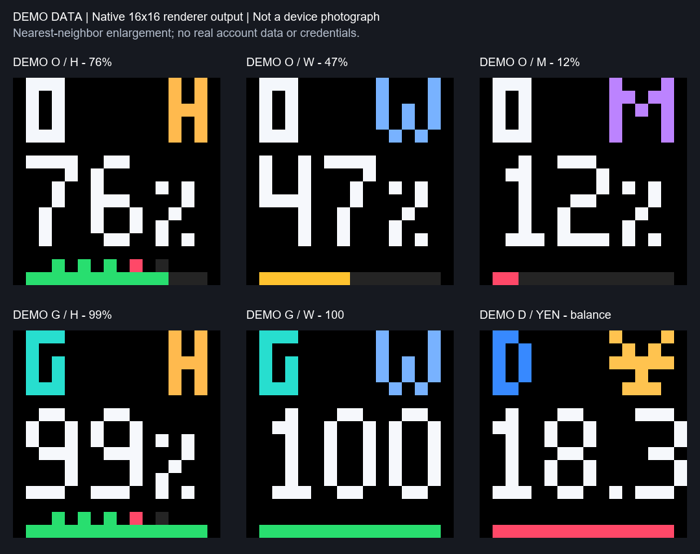
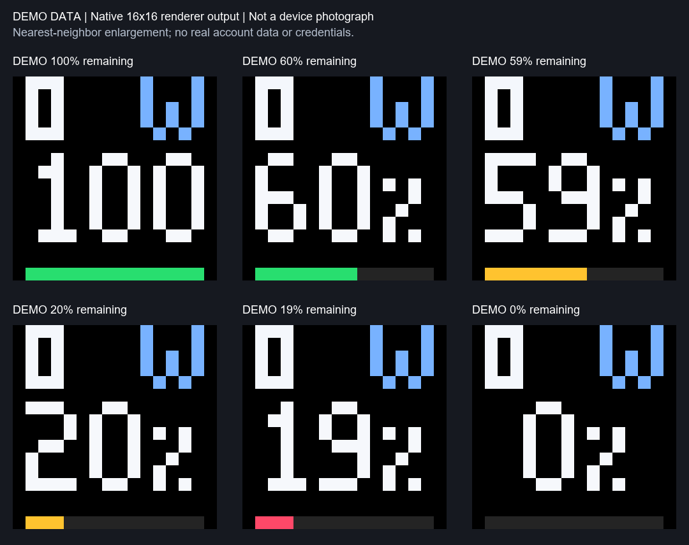
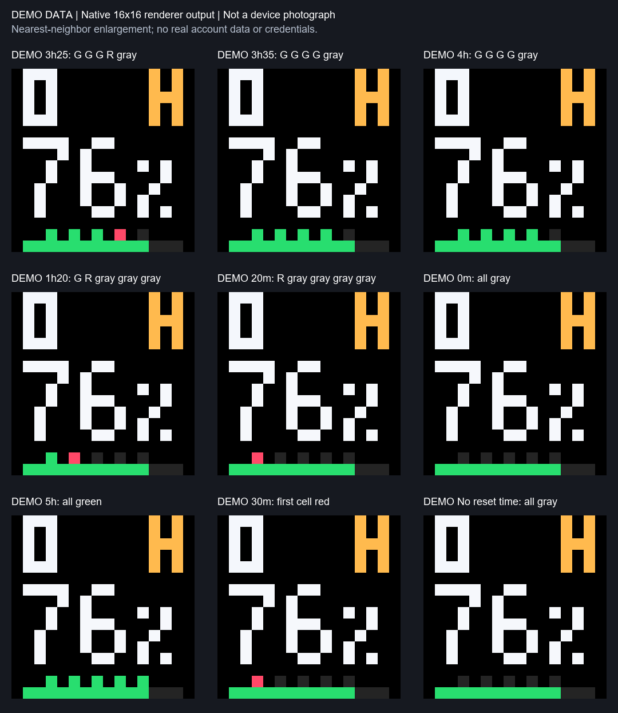
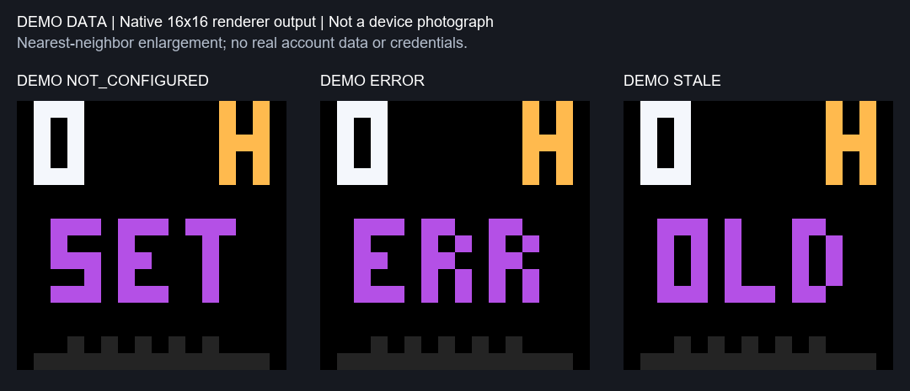
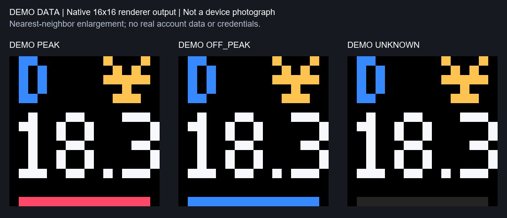

# Pixoo AI 监控

在 Windows 上查看 OpenCode Go、Codex 和 DeepSeek 状态，并将画面轮播到第一代 Divoom Pixoo 16×16 蓝牙屏。

## 下载与启动

从 [Releases](https://github.com/NoireCase/pixoo-ai-monitor/releases) 下载 Windows 发行包，完整解压后双击 `Pixoo AI 监控.exe`。EXE 与 `_internal` 等资源必须保存在同一目录；无需另装 Python。Codex 数据仍需要本机已安装并登录 Codex CLI。

1. 在 Windows 中配对 Pixoo，在“设备 → 高级设备设置”填写设备地址与端口。
2. 在“服务”中为 OpenCode Go 和 DeepSeek 保存 API Key；密钥保存在当前用户的 Windows 凭据管理器。Codex 使用原有 CLI 登录。
3. 点击“开始工作”。首页展示后台真实额度、余额、蓝牙连接以及最近成功发送的画面。
4. 点击窗口 × 可隐藏到托盘，后台继续运行；点击“停止工作”才停止监控。托盘菜单可重新打开控制中心。

可在“设置”中主动启用或取消 Windows 登录后自动运行。配置、日志和缓存位于当前用户的 `%LOCALAPPDATA%\Pixoo AI Monitor V1`，请勿上传其中的配置、日志或凭据。

## 功能

- OpenCode Go 的 5 小时、7 天和 30 天剩余额度；Codex 的 5 小时、7 天剩余额度；DeepSeek 官方 API 余额与北京时间峰谷状态。
- classic、B2、B3 样式，六页轮播、刷新间隔、亮度、服务和页面启停。
- 控制中心与后台独立运行；当前用户本地通信使用受限管道和签名请求，凭据通过 Windows Credential Manager 保存。
- 健康检查、中文蓝牙诊断、最近发送帧导出、脱敏诊断包、日志与配置备份。

## 升级与回滚

先停止旧版后台并等待退出，再打开新版；不要让两个程序争用同一 Pixoo。旧版与新版的凭据名称兼容。V1 使用独立数据目录，首次运行时可能从旧项目的本机路径复制配置；其他位置的旧配置需手动迁移并核对。请先备份配置。若要回滚，先在新版点击“停止工作”，确认退出，再启动旧版。

## 限制与反馈

当前为预览发行：六页真实画面已由用户目视确认，但跨电脑、长期运行、Win+L、睡眠恢复、登录自启及无 Python 机器仍需进一步验收。历史节假日日历只覆盖已确认日期，未覆盖年份峰谷状态可能显示未知。后台发送成功不等同于实体屏幕已目视确认。

遇到问题可在 [Issues](https://github.com/NoireCase/pixoo-ai-monitor/issues) 反馈，请勿公开 API Key、令牌、完整设备地址或私人余额。

版本变化见 [版本更新.md](版本更新.md) 和 [CHANGELOG.md](CHANGELOG.md)。项目使用 MIT 许可，依赖和 PixooCtrl 署名见第三方许可文件。
## 屏幕画面示意

以下图片使用合成数据展示 B3 的六页、额度颜色、倒计时、异常提示及峰谷状态，并非当前账户的真实读数。

